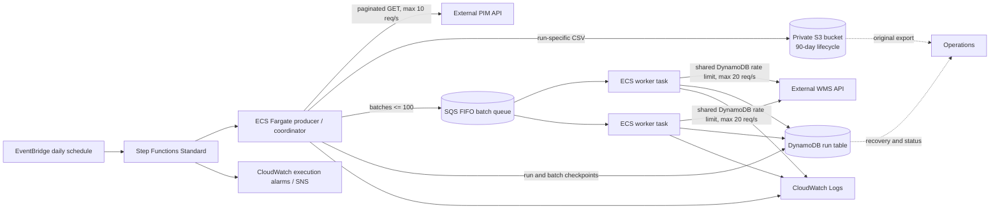

# Product Catalogue Synchronisation Architecture

## Overview



## Execution and data flow

1. EventBridge starts one Step Functions Standard execution each day. The workflow passes its execution name to the Fargate task as the run ID, and runs one task synchronously so the execution has a visible running, succeeded, or failed state. A global checkpoint lock prevents different runs from processing concurrently.
2. The task fetches PIM pages sequentially, with a maximum page size of 500 and a process-wide 10 requests/second limiter. It writes rows incrementally to a temporary CSV. Only a complete export is atomically published locally and uploaded to a run-specific S3 key (`catalogue/<run-id>/catalogue.csv`).
3. The producer reads the retained export, validates duplicate SKUs with a disk-backed SQLite index, and sends transformed batches of no more than 100 products to an SQS FIFO queue. It uses `SendMessageBatch` to publish up to ten queue messages per SQS API call. Different batch IDs use different message groups so independent ECS worker tasks can process batches in parallel; duplicate deliveries of a given batch remain ordered together.
4. The ECS worker service runs independent Fargate tasks (four minimum by default, configurable with `worker_desired_count`). ECS Application Auto Scaling adjusts the task count between that minimum and `worker_max_capacity` (32 by default), targeting 10 visible queue batches per running worker. Container Insights provides the running-task metric and may incur CloudWatch charges. A worker enables ECS task scale-in protection while processing a batch and removes protection when idle. Each worker reuses one HTTP client connection pool across batches. Each WMS HTTP attempt emits a CloudWatch Embedded Metric Format event for request latency, attempt count, and errors. Each task takes a queue message, claims the batch in DynamoDB, submits it to the WMS, stores the outcome, and deletes the message only after the outcome is checkpointed. A DynamoDB-backed shared limiter reserves request slots across worker processes and caps WMS request attempts at 20 per second total.
5. The producer/coordinator waits for all expected batch outcomes and reports the run complete only after the workers have checkpointed every batch. DynamoDB stores each batch's accepted/rejected SKU outcomes and counts together, avoiding a separate database write for each product.
6. SQS retries unprocessed messages and routes repeatedly failing messages to a dead-letter queue, which has a CloudWatch alarm. A batch redelivered while its checkpoint is still `IN_FLIGHT` becomes `AMBIGUOUS`, not automatically replayed. S3 lifecycle configuration expires catalogue exports after 90 days. DynamoDB retention remains a separate operational policy.

The queued producer has a four-hour run deadline by default
(`RUN_COMPLETION_TIMEOUT_SECONDS=14400`). With the current 10 PIM requests per
second, 500 products per page, 20 WMS requests per second, and 100 products per
batch, 10 million products have a theoretical sequential minimum of about 1
hour 57 minutes. This is only a capacity estimate: API latency, retries,
dispatch, checkpoints, and worker scale-out must be measured in AWS.

For local execution without AWS, `S3Store` uses the filesystem and `CheckpointStore` uses SQLite by default; the existing in-process threaded WMS path remains available. The Terraform deployment uses SQS and DynamoDB to distribute work to independent ECS workers. LocalStack can emulate these AWS services as well as the Step Functions-to-ECS workflow. Leave the AWS endpoint unset when using real AWS.

Checkpoint code is split by responsibility: `checkpoint.py` defines the shared
interface, `checkpoint_sqlite.py` contains the local SQLite backend, and
`checkpoint_dynamodb.py` contains the shared DynamoDB backend. Storage calls are
synchronous; local WMS requests are overlapped with a bounded thread pool.

## Running and testing locally

Prerequisites are Python 3.11 or later and Docker Desktop with Docker Compose. Run the following from the repository root.

1. Start the mock PIM and WMS APIs in a terminal:

   ```powershell
   docker compose up --build
   ```

   The APIs are available at `http://localhost:8001` and `http://localhost:8002`; their interactive documentation is at `/docs` on each address. Leave this terminal running while using the application.

2. In a second terminal, create and activate a virtual environment, then install the dependencies:

   ```powershell
   py -3 -m venv .venv
   .\.venv\Scripts\Activate.ps1
   python -m pip install -r requirements.txt
   ```

   If PowerShell blocks activation, use `.\.venv\Scripts\python.exe` in place of `python` in the following commands.

3. Run the test suite:

   ```powershell
   python -m pytest
   ```

   These tests exercise the local application logic and mocked HTTP responses; they do not require AWS credentials or a deployed AWS environment.

4. Run a full catalogue synchronization against the mock APIs:

   ```powershell
   python -m app.main
   ```

   The command prints a JSON run summary. By default, exports are stored under `runtime/s3/` and checkpoints in `runtime/state.sqlite3`. Use a new run ID for a fresh run, or reuse a failed run's ID to resume it:

   ```powershell
   python -m app.main --run-id local-run-001
   ```

   A run with an ambiguous WMS outcome is intentionally blocked; it cannot be safely resumed until the outcome is reconciled. For environment overrides and AWS-mode setup, see [README.md](./README.md).

5. Stop the mock APIs with `Ctrl+C` in the first terminal. To stop and remove the Compose containers from another terminal, run `docker compose down`.

## Failure, retry, and recovery

- PIM GET requests retry 429 and common 5xx responses and transport errors with exponential backoff, honoring `Retry-After`; each retry passes through the rate limiter. A failed export never replaces an earlier local export, and an S3 object is not published until the export is complete.
- WMS 429 responses are retried with backoff and the shared DynamoDB rate limiter. For the supplied loopback mock only, HTTP 500 is also retried: its rate-limit branch raises a framework error before processing the batch because the mock passes `JSONResponse` arguments in the wrong order. For a remote WMS, 5xx responses and transport errors are **not** retried automatically: the WMS may have committed a request before the response was lost. The batch and run become `AMBIGUOUS`, and a rerun with the same run ID is blocked pending reconciliation.
- The implementation assumes a WMS 429 means that request was rejected before processing, as is conventional for rate limiting; if the WMS can apply a request and still return 429, even that retry must be disabled until idempotency is available.
- A process restart or SQS redelivery with an in-flight WMS batch also becomes `AMBIGUOUS`. Completed batch outcomes are skipped on resume, so known successful products are not sent again. Rejected products are checkpointed with their reasons and are not blindly resubmitted.
- A global run lock serializes scheduled and manually started runs. The DynamoDB-backed request limiter is shared by all ECS worker tasks, so adding workers does not multiply the WMS rate cap. The lock is released only after a run completes; a failed or ambiguous run retains it so a later daily run cannot race with unresolved work. Resume the same run ID after a definitive failure. A stale lock after a process or infrastructure failure requires operator recovery.
- A malformed 2xx WMS response is also ambiguous because the server may have accepted some or all records. A definitive non-retryable client error fails the run.
- WMS partial success is treated as a complete response only when every submitted SKU is accounted for exactly once as accepted or rejected. Any missing, duplicated, or unexpected SKU makes the batch ambiguous.
- Operations should use the run ID to inspect the Step Functions execution, CloudWatch logs, DynamoDB run/batch records, and the S3 export. For an ambiguous batch, compare the batch SKUs with WMS state and record the resolution before any replay. The current application intentionally provides no automatic “force retry” switch.

## Duplicate semantics and assumptions

The requirement that “the same product must never be sent twice” is not fully implementable by the integration alone. The WMS API shown in the assessment does not describe an idempotency token, a request-status lookup, or a uniqueness contract. The code therefore provides **at-most-once automatic submission per SKU within a run** and will halt on any outcome it cannot prove. It cannot guarantee exactly-once delivery across a remote WMS and a local/DynamoDB checkpoint: a crash after WMS acceptance but before checkpoint completion necessarily leaves an ambiguous batch.

Separate daily runs may submit the same SKU again because a catalogue synchronisation must deliver changed product data. The assumption is that the business means “no duplicate submission within one logical run,” while legitimate updates on subsequent runs remain necessary. If the business means a SKU may only ever be accepted once, the integration must not run daily updates; that policy needs confirmation.

The production solution should agree with the WMS team on an idempotency key (ideally stable product ID plus source version/run ID), a deduplication retention window, and a lookup/reconciliation API. With those guarantees, retries of ambiguous requests can be safe. Until then, stopping and reconciling sacrifices automatic recovery to protect against duplicate side effects.

The supplied PIM pagination API is treated as a consistent snapshot for the duration of a run. If it can change between pages, it must expose a snapshot/version token or a change feed; otherwise inserts/deletes during pagination can cause omissions or duplicates.

## Scaling and the 10-million-product objective

At 10 million products, the PIM needs at least 20,000 pages and the WMS at
least 100,000 requests at the current maximum page and batch sizes. The request
rate ceilings imply minimums of roughly 33 minutes 20 seconds for PIM and 1
hour 23 minutes 20 seconds for WMS. Since export precedes WMS dispatch, the
ideal overall lower bound is about 1 hour 57 minutes before API latency,
backoff, dispatch, checkpointing, and worker scale-out. A 30-minute target is
not possible without raising API throughput or adding a bulk data path.

In Terraform/AWS mode, the WMS stage uses independent ECS tasks reading from SQS. ECS Application Auto Scaling targets the visible SQS backlog per running task, with a minimum of `worker_desired_count` (four by default) and a maximum of `worker_max_capacity` (32 by default). Container Insights supplies the running-task metric. A DynamoDB conditional-write limiter coordinates the 20-request/second ceiling across those processes; adding workers can improve utilization when API responses are slow, but cannot raise the WMS limit. The local no-AWS mode still uses a bounded thread pool.

Batch numbers are deterministic from CSV order. Completed batches are skipped on resume; definitive failed batches can be claimed again only with the same product payload. In-flight batches found after a process restart become ambiguous, and the run is blocked. A bounded disk-backed SQLite SKU index detects duplicate product IDs across the entire CSV without keeping all product IDs in Python memory. DynamoDB stores outcomes alongside each batch record, keeping each batch's status, SKU details, and counts together.

The four-hour timeout is a guardrail, not proof that the distributed deployment
will finish 10 million products in time. A local synthetic one-million-record
run completed in 10.4 minutes through the four-thread WMS path, a deterministic
immediate HTTP stub, and SQLite checkpoints, with the 20-requests/second
limiter enabled. It excluded PIM export, S3, SQS, DynamoDB, and ECS autoscaling.
A prior LocalStack queue benchmark did not complete, and the supplied PIM mock
contains only 12,000 products. Production readiness still requires an
end-to-end 10-million-product run with representative API latency, throttling,
checkpoint load, and failure scenarios. The WMS still has no idempotency key
or status lookup; uncertain requests must be reconciled rather than
automatically replayed.

## AWS services, security, and observability

- **EventBridge Scheduler / Step Functions Standard:** daily start, durable workflow status, bounded retries for task launch/infrastructure errors, and a synchronous task boundary. Do not configure Step Functions to automatically restart an ambiguous business run.
- **ECS Fargate:** a one-shot producer/coordinator task plus a separately deployed worker service. Application Auto Scaling adjusts worker count against SQS backlog per running task, within configured minimum and maximum capacities; private subnets with controlled NAT egress are expected because the external APIs are outside the VPC.
- **SQS FIFO:** durable batch distribution with per-batch message groups, bounded redelivery, and a dead-letter queue alarm. The queue is at-least-once; DynamoDB batch claims and ambiguous-state handling prevent blind resubmission.
- **S3:** private bucket, server-side encryption, public-access blocks, run-specific object keys, and 90-day lifecycle expiry. The task role is scoped to this bucket's catalogue prefix.
- **DynamoDB:** on-demand table keyed by run partition and item sort key, point-in-time recovery enabled, holding run state, batch state, export key, per-SKU outcomes, and a shared WMS request-slot record. The task role is limited to this table.
- **Secrets Manager:** API keys are injected as ECS secrets and must not be emitted in logs. Secret values are provisioned out-of-band, not stored in Terraform source.
- **IAM:** separate task execution and application task roles; least-privilege object/table permissions; `iam:PassRole` restricted to the two ECS roles; no public S3 access.
- **CloudWatch:** container logs retained for 90 days, Step Functions failure/timeout alarms routed to SNS, and final run counts/status emitted by the application. A worker dashboard shows WMS request rate and latency, SQS visible/in-flight backlog and oldest-message age, running worker count, and visible batches per worker. WMS request metrics are extracted from Embedded Metric Format log events; the request-rate chart reports a one-minute average. Page latency, retry rates, rejected/ambiguous outcomes, and whole-run duration still need richer metrics and alert thresholds.

Terraform under `terraform/` expresses this deployment boundary. Supply an immutable image URI and networking/secrets inputs for a real deployment. The local mocks are not deployed by Terraform and must not be modified.
