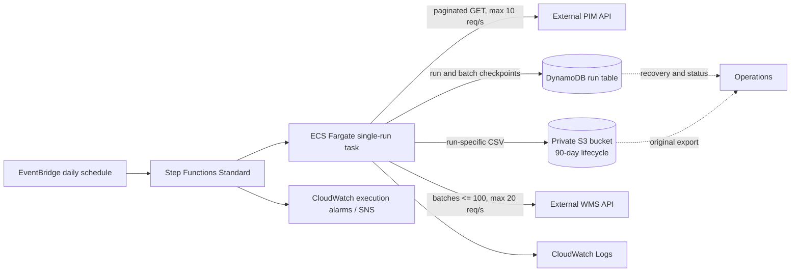

# Product Catalogue Synchronisation Architecture

## Overview



## Execution and data flow

1. EventBridge starts one Step Functions Standard execution each day. The workflow passes its execution name to the Fargate task as the run ID, and runs one task synchronously so the execution has a visible running, succeeded, or failed state. A global checkpoint lock prevents different runs from processing concurrently.
2. The task fetches PIM pages sequentially, with a maximum page size of 500 and a process-wide 10 requests/second limiter. It writes rows incrementally to a temporary CSV. Only a complete export is atomically published locally and uploaded to a run-specific S3 key (`catalogue/<run-id>/catalogue.csv`).
3. The task reads the retained export and streams transformed records to the WMS in batches no larger than 100. Requests are sequential and limited to 20/second. The single-worker design makes the rate limit enforceable without a distributed limiter and avoids concurrent duplicate submission.
4. Before a WMS request, the task durably records the batch as `IN_FLIGHT`. After a well-formed response, it checkpoints every accepted and rejected SKU and marks the batch complete. The run summary contains status, export key, and accepted/rejected counts.
5. S3 lifecycle configuration expires catalogue exports after 90 days. DynamoDB retains run and per-SKU outcomes for operational investigation; retention/archival for this table is a separate operational policy.

For local execution, `S3Store` uses the filesystem and `CheckpointStore` uses SQLite by default. LocalStack can emulate the AWS services in the Terraform deployment, including the Step Functions-to-ECS workflow. Set `S3_BUCKET`, `DYNAMODB_TABLE`, and `AWS_ENDPOINT_URL` for a host-run app, or use the LocalStack Terraform configuration to create and execute the full workflow. Leave the endpoint unset when using real AWS. The same pipeline and checkpoint interface are used in all modes.

## Running and testing locally

Prerequisites are Python 3.11 or later and Docker Desktop with Docker Compose. Run the following from the repository root.

1. Start the mock PIM and WMS APIs in a terminal:

   ```powershell
   docker compose up --build
   ```

   The APIs are available at `http://localhost:8001` and `http://localhost:8002`; their interactive documentation is at `/docs` on each address. Leave this terminal running while using the application.

2. In a second terminal, create and activate a virtual environment, then install the dependencies:

   ```powershell
   py -3 -m venv .venv
   .\.venv\Scripts\Activate.ps1
   python -m pip install -r requirements.txt
   ```

   If PowerShell blocks activation, use `.\.venv\Scripts\python.exe` in place of `python` in the following commands.

3. Run the test suite:

   ```powershell
   python -m pytest
   ```

   These tests exercise the local application logic and mocked HTTP responses; they do not require AWS credentials or a deployed AWS environment.

4. Run a full catalogue synchronization against the mock APIs:

   ```powershell
   python -m app.main
   ```

   The command prints a JSON run summary. By default, exports are stored under `runtime/s3/` and checkpoints in `runtime/state.sqlite3`. Use a new run ID for a fresh run, or reuse a failed run's ID to resume it:

   ```powershell
   python -m app.main --run-id local-run-001
   ```

   A run with an ambiguous WMS outcome is intentionally blocked; it cannot be safely resumed until the outcome is reconciled. For environment overrides and AWS-mode setup, see [README.md](./README.md).

5. Stop the mock APIs with `Ctrl+C` in the first terminal. To stop and remove the Compose containers from another terminal, run `docker compose down`.

## Failure, retry, and recovery

- PIM GET requests retry 429 and common 5xx responses and transport errors with exponential backoff, honoring `Retry-After`; each retry passes through the rate limiter. A failed export never replaces an earlier local export, and an S3 object is not published until the export is complete.
- WMS 429 responses are retried with backoff and rate limiting. For the supplied loopback mock only, HTTP 500 is also retried: its rate-limit branch raises a framework error before processing the batch because the mock passes `JSONResponse` arguments in the wrong order. For a remote WMS, 5xx responses and transport errors are **not** retried automatically: the WMS may have committed a request before the response was lost. The batch and run become `AMBIGUOUS`, and a rerun with the same run ID is blocked pending reconciliation.
- The implementation assumes a WMS 429 means that request was rejected before processing, as is conventional for rate limiting; if the WMS can apply a request and still return 429, even that retry must be disabled until idempotency is available.
- A process restart with an in-flight WMS batch also becomes `AMBIGUOUS`. Completed batch outcomes are skipped on resume, so known successful products are not sent again. Rejected products are checkpointed with their reasons and are not blindly resubmitted.
- A global run lock serializes scheduled and manually started runs so independent executions cannot exceed the WMS rate limit collectively. It is released only after a run completes; a failed or ambiguous run retains it so a later daily run cannot race with unresolved work. Resume the same run ID after a definitive failure. A stale lock after a process or infrastructure failure requires operator recovery.
- A malformed 2xx WMS response is also ambiguous because the server may have accepted some or all records. A definitive non-retryable client error fails the run.
- WMS partial success is treated as a complete response only when every submitted SKU is accounted for exactly once as accepted or rejected. Any missing, duplicated, or unexpected SKU makes the batch ambiguous.
- Operations should use the run ID to inspect the Step Functions execution, CloudWatch logs, DynamoDB run/batch records, and the S3 export. For an ambiguous batch, compare the batch SKUs with WMS state and record the resolution before any replay. The current application intentionally provides no automatic “force retry” switch.

## Duplicate semantics and assumptions

The requirement that “the same product must never be sent twice” is not fully implementable by the integration alone. The WMS API shown in the assessment does not describe an idempotency token, a request-status lookup, or a uniqueness contract. The code therefore provides **at-most-once automatic submission per SKU within a run** and will halt on any outcome it cannot prove. It cannot guarantee exactly-once delivery across a remote WMS and a local/DynamoDB checkpoint: a crash after WMS acceptance but before checkpoint completion necessarily leaves an ambiguous batch.

Separate daily runs may submit the same SKU again because a catalogue synchronisation must deliver changed product data. The assumption is that the business means “no duplicate submission within one logical run,” while legitimate updates on subsequent runs remain necessary. If the business means a SKU may only ever be accepted once, the integration must not run daily updates; that policy needs confirmation.

The production solution should agree with the WMS team on an idempotency key (ideally stable product ID plus source version/run ID), a deduplication retention window, and a lookup/reconciliation API. With those guarantees, retries of ambiguous requests can be safe. Until then, stopping and reconciling sacrifices automatic recovery to protect against duplicate side effects.

The supplied PIM pagination API is treated as a consistent snapshot for the duration of a run. If it can change between pages, it must expose a snapshot/version token or a change feed; otherwise inserts/deletes during pagination can cause omissions or duplicates.

## Scaling and the 30-minute objective

At 250,000 products, the PIM needs at least 500 pages and the WMS at least 2,500 requests at its maximum batch size; at one million products those become 2,000 and 10,000 requests. The request-rate ceilings imply ideal minimums of roughly 50 seconds/200 seconds for PIM and 125 seconds/500 seconds for WMS, before network latency, backoff, export, and processing. This leaves room under 30 minutes only if actual WMS response latency is modest.

The first implementation intentionally uses one sequential worker because the WMS duplicate contract is unresolved and a global 20 requests/second ceiling cannot safely be enforced by independent workers. Before adding parallel WMS workers, benchmark the one-worker solution against representative latency. If it misses the SLA, introduce bounded concurrency only after adding a shared DynamoDB token bucket (or another distributed limiter), durable per-batch leases, and WMS idempotency/reconciliation. Parallelize CPU/I/O work only where it does not violate ordering or duplicate semantics.

## AWS services, security, and observability

- **EventBridge Scheduler / Step Functions Standard:** daily start, durable workflow status, bounded retries for task launch/infrastructure errors, and a synchronous task boundary. Do not configure Step Functions to automatically restart an ambiguous business run.
- **ECS Fargate:** isolated, ephemeral Python runtime with enough memory/disk for the export. Private subnets with controlled NAT egress are expected because both external APIs are outside the VPC.
- **S3:** private bucket, server-side encryption, public-access blocks, run-specific object keys, and 90-day lifecycle expiry. The task role is scoped to this bucket's catalogue prefix.
- **DynamoDB:** on-demand table keyed by run partition and item sort key, point-in-time recovery enabled, holding run state, batch state, export key, and per-SKU outcomes. The task role is limited to this table.
- **Secrets Manager:** API keys are injected as ECS secrets and must not be emitted in logs. Secret values are provisioned out-of-band, not stored in Terraform source.
- **IAM:** separate task execution and application task roles; least-privilege object/table permissions; `iam:PassRole` restricted to the two ECS roles; no public S3 access.
- **CloudWatch:** container logs retained for 90 days, Step Functions failure/timeout alarms routed to SNS, and final run counts/status emitted by the application. Production should add dashboards and custom metrics for page/batch latency, retries, throughput, rejected SKUs, ambiguous outcomes, and duration.

Terraform under `terraform/` expresses this deployment boundary. Supply an immutable image URI and networking/secrets inputs for a real deployment. The local mocks are not deployed by Terraform and must not be modified.
